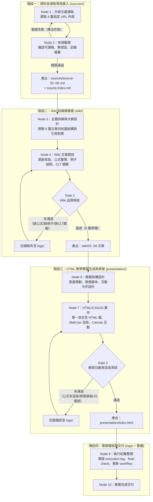

# CLT-Wiki 專案工作流程規範

**更新時間**：2026-11-14  
**專案主題**：中央極限定理：為什麼平均數會趨近常態分配？

---

## 一、流程架構總覽

以下流程圖呈現四個階段的完整資料流向，以及兩個品質回饋迴圈（Loop 1、Loop 2）：



---

## 二、各節點詳細說明

### 階段一：資料來源取得與匯入

#### Node 1：外部文獻擷取

- **輸入**：作業指定的 6 個 URL（OpenStax Statistics 2e、OpenStax Business Statistics 2e、Penn State STAT 414）。
- **處理方式**：
  1. 連線讀取各頁面的內容，確認網址有效。
  2. 擷取標題、機構名稱、章節主題、核心公式與定義。
  3. 以摘要形式整理每篇的重要概念，不直接複製原文大段文字。
- **輸出**：各篇來源的摘要草稿。

#### Node 2：來源驗證

- **輸入**：Node 1 的摘要草稿。
- **處理方式**：
  1. 確認 6 篇文獻皆可正常取得，無失效連結或內容缺失。
  2. 建立統一的來源索引，記錄各篇的引用對應關係。
  3. 若有無法取得的來源，明確標記，不以臆測內容替代。
- **輸出**：
  - `sources/source-01.md` ～ `sources/source-06.md`
  - `sources/source-index.md`

---

### 階段二：Wiki 知識庫建置

#### Node 3：主題拆解與大綱設計

- **輸入**：`sources/source-index.md` 與 6 篇來源摘要。
- **處理方式**：
  1. 將「中央極限定理：為什麼平均數會趨近常態分配？」拆解為學習路徑：母體與樣本 → 抽樣分配 → 樣本平均數 → 常態分配 → 中央極限定理 → 實務應用。
  2. 確定各篇文章的主題焦點與引用的來源文獻。
- **輸出**：6 篇文章的寫作大綱與公式清單。

#### Node 4：Wiki 文章撰寫

- **輸入**：Node 3 的大綱規劃與 sources 摘要。
- **處理方式**：
  1. 以自己的文字整理各主題，不大段複製教材原文。
  2. 每篇文章必須包含以下六個區塊：
     - 概念介紹
     - 重要定義
     - 必要的數學公式（Markdown LaTeX 語法）
     - 具體例子
     - 與中央極限定理的關聯
     - 資料來源（標記對應的 sources 編號）
- **輸出**：
  - `wiki/01-母體與樣本.md`
  - `wiki/02-抽樣分配.md`
  - `wiki/03-樣本平均數.md`
  - `wiki/04-常態分配.md`
  - `wiki/05-中央極限定理.md`
  - `wiki/06-中央極限定理的應用.md`

#### Gate 1：Wiki 品質檢核

**檢驗項目**：
- 是否 6 篇文章皆具備規定的 6 個必要區塊？
- 數學公式是否正確（包含期望值 $E(\bar{X})=\mu$、標準誤 $\sigma/\sqrt{n}$）？
- 是否以原創文字整理，無大段複製教材原文？
- 每篇是否明確說明與中央極限定理的關聯？
- 資料來源標記是否與 `sources/` 目錄一致？

**通過** → 進入階段三。  
**未通過** → 觸發 **Loop 1**，退回 Node 4 修訂有問題的文章。

---

### 階段三：HTML 教學簡報生成與修復

#### Node 6：簡報架構設計

- **輸入**：通過 Gate 1 的 `wiki/*.md` 知識庫。
- **處理方式**：
  1. 規劃各頁投影片的主題焦點、公式、圖表與互動元件。
  2. 設計第 10 頁 CLT 互動實驗室的技術規格（指數母體、$n$ 切換、$R=2500$ 次重複抽樣、Canvas 直方圖）。
- **輸出**：投影片架構腳本。

#### Node 7：HTML/CSS/JS 實作

- **輸入**：Node 6 的設計腳本。
- **處理方式**：
  1. 實作單一自包含 HTML 檔，所有 CSS 與 JavaScript 內嵌。
  2. 整合 MathJax 3 渲染引擎，支援 `$...$` 行內公式與 `$$...$$` 區塊公式。
  3. 實作投影片切換（按鈕 + 鍵盤方向鍵）、Canvas 抽樣模擬繪圖等互動功能。
- **輸出**：`presentation/index.html`

#### Gate 2：網頁功能與渲染測試

**檢驗項目**：
- 數學公式是否透過 MathJax 正確渲染，無原始 LaTeX 語法殘留？
- 投影片切換與鍵盤導覽是否正常？
- 第 10 頁互動功能（$n$ 切換按鈕、重新抽樣、直方圖繪製、統計數據更新）是否全數正常？
- 版面在各頁是否無文字重疊或超出邊界？

**通過** → 進入階段四。  
**未通過** → 觸發 **Loop 2**，退回 Node 7 修復。

---

### 階段四：專案稽核與交付

#### Node 9：執行紀錄整理

- **輸入**：整個流程中各階段的產出與錯誤修復過程。
- **處理方式**：
  1. 整理各次修改過程，撰寫具時間戳記的執行日誌至 `logs/`。
  2. 建立 `logs/execution-log.md` 與 `logs/final-check.md`，更新 `workflow/workflow.md`。
- **輸出**：`logs/*.md`、更新後的 `workflow/workflow.md`。

#### Node 10：專案完成交付

- **輸出**：完整的 CLT-Wiki 課程作業專案。

---

## 三、重複執行步驟與品質檢查機制

| 階段 | 步驟 | 是否重複執行 | 觸發條件 | 品質檢查重點 |
| :--- | :--- | :---: | :--- | :--- |
| 階段一 | Node 1 & 2 | 否（一次性） | 僅在新增文獻時重跑 | 來源可存取性、無捏造 |
| 階段二 | **Node 4**（Wiki 撰寫） | **是（Loop 1）** | Gate 1 未通過時 | 6 大區塊完整、公式正確、原創文字、CLT 關聯 |
| 階段二 | **Gate 1** | **是（Loop 1）** | Node 4 每次修訂後重新審查 | 逐篇逐條檢驗 |
| 階段三 | **Node 7**（HTML 實作） | **是（Loop 2）** | Gate 2 未通過時 | 公式渲染、JS 事件、CSS 佈局 |
| 階段三 | **Gate 2** | **是（Loop 2）** | Node 7 每次修復後重新測試 | 瀏覽器渲染、互動功能、版面完整性 |
| 階段四 | Node 9 | 否（收尾一次） | 專案交付前 | 文件完整、事實正確 |

---

## 四、兩大品質回饋迴圈

```
Loop 1（Wiki 內容品質迴圈）
Node 4（文章撰寫）→ Gate 1（內容檢核）─[未通過]→ 記錄缺失 → 返回 Node 4 修訂
     ↑_______________________________________________|

Loop 2（HTML 簡報測試迴圈）
Node 7（HTML 實作）→ Gate 2（網頁測試）─[未通過]→ 記錄錯誤 → 返回 Node 7 修復
     ↑_______________________________________________|
```

### Loop 1：Wiki 內容品質迴圈

- **失敗條件**：某篇文章缺少必要區塊（例如缺具體例子）、公式寫錯（例如標準誤漏寫 $\sqrt{n}$）、或未說明與 CLT 的關聯。
- **退回機制**：在 `logs/` 記錄具體缺失後，僅針對有問題的文章退回 Node 4 修訂，其他已合格文章不受影響。
- **重新檢驗**：修訂完成後重新執行 Gate 1，直到 6 篇全數通過。

### Loop 2：HTML 簡報測試迴圈

- **失敗條件**：數學公式出現原始 LaTeX 語法未渲染、投影片按鈕或鍵盤無反應、Canvas 圖表未繪製、版面文字重疊或超出邊界。
- **退回機制**：在 `logs/` 記錄錯誤後，退回 Node 7 修復，可能涉及 HTML 結構、CSS、JavaScript 或 MathJax 設定。
- **重新測試**：修復完成後重新執行 Gate 2，直到通過為止。

---

## 五、流程設計理念

1. **內容與表現分離**：Wiki 知識庫（markdown）與 HTML 簡報（前端）分屬獨立階段，各自有品質閘門把關。Wiki 的知識正確性不因簡報的版面限制而妥協，簡報的視覺設計也不受 markdown 格式束縛。

2. **問題盡早發現**：Gate 1 確保知識層的正確性後，Gate 2 再處理呈現層的問題，避免公式錯誤一直帶進 HTML 生成階段才被發現，增加修復成本。

3. **兩個迴圈互不干擾**：内容修訂問題（改 markdown）走 Loop 1；版面與程式問題（改 HTML/JS）走 Loop 2。這樣設計避免修一個網頁排版問題時意外動到知識內容，也避免反過來。

4. **全程留下紀錄**：每次修改、每次測試結果都記錄在 `logs/` 下，作為學術誠信的依據，也方便日後查閱或修改。
